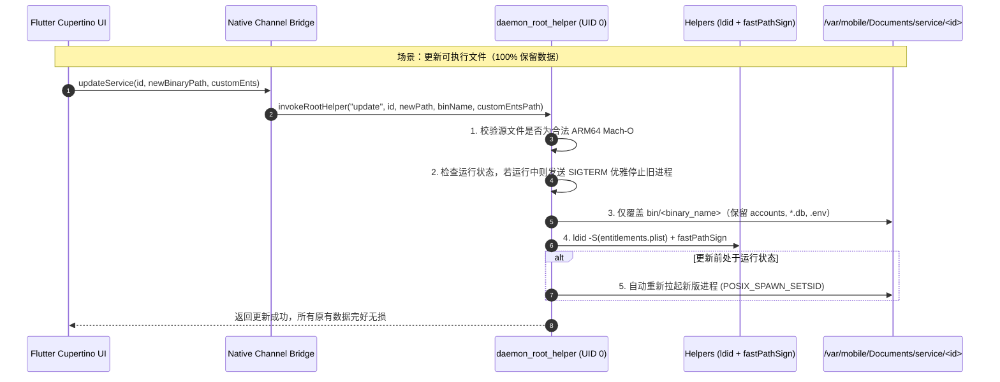

# 🌟 TrollService (TrollStore 微服务与守护进程管理器)

<p align="center">
  <strong>优雅的 TrollStore 原生常驻微服务与守护进程管理平台</strong><br>
  无需命令行，将你的 iPhone / iPad 变成便携式 24/7 低功耗微型服务器。
</p>

<p align="center">
  
  
  
  
  
</p>

---

## 📖 项目简介 (Overview)

**TrollService** 是一款专为已安装 **TrollStore** 的 iOS 设备（iOS 14.0 – 16.6.1 / 17.0）打造的图形化微服务与守护进程管理器。

借助 TrollStore 的 CoreTrust 绕过机制与 root 提权特性，TrollService 让用户无需连接电脑、无需通过 SSH 终端敲代码，即可在手机端**一键安装、签名赋权、启停、监控并平滑升级**各类单二进制后台程序（如 [AIStudio2API](https://github.com/Mag1cFall/AIStudio2API)、[Alist](https://github.com/alist-org/alist)、[Sing-Box](https://github.com/SagerNet/sing-box)、[One-API](https://github.com/songquanpeng/one-api)、[Cloudflared](https://github.com/cloudflare/cloudflared) 等）。

---

## 🎯 解决的核心痛点 (Why TrollService?)

| 痛点场景 | 传统方式（命令行 / 脚本） | TrollService 解决方案 |
| :--- | :--- | :--- |
| **签名与赋权** | 必须电脑端或 SSH 手动敲 `ldid -S` 和 `fastPathSign`，权限参数极易配错导致闪退 | **内置设备端自动化签名流水线**，手机端一键自动注入免沙盒与 CoreTrust 证书 |
| **后台被强杀** | 手机锁屏或切换后台时，系统 Jetsam 内存管理机制会立即无情杀掉进程 | **Root 特权独立守护进程** + `memorystatus_control` Jetsam 豁免，锁屏后依然 24/7 稳定常驻 |
| **版本更新丢失数据** | 重新解压或运行脚本覆盖，常误将数据库、Cookie、登录凭证清空 | **更新程序 100% 保留数据**，仅替换可执行文件并重签，数据库与凭据毫发无损 |
| **环境变量被篡改** | 启动脚本容易用预设参数粗暴覆写用户自定义配置 | **工作目录优先保护**，绝不覆写已存在的 `.env`，完整保留用户注释与自定参数 |
| **运行状态不可视** | 查进程得输 `ps aux`，看报错得手动 `cat` 日志，端口开没开纯靠猜 | **高精度实时探针**：真实 PID、物理内存 RSS、运行时间、TCP 端口连通状态与流式日志监控 |

---

## ✨ 核心特性 (Key Features)

### 1. 📱 纯正 iOS 原生质感 (Cupertino HIG)
- 遵循 Apple 人机交互规范（HIG），提供沉浸式 iOS 原生视觉、平滑的卡片过渡与灵敏的触觉震动反馈（Haptic Feedback）。
- 完美适配深色模式（Dark Mode）与灵动岛 / 刘海屏安全区。

### 2. 🛡️ 移动端自动化签名与自定义 Entitlements
- **手机内置签名引擎**：应用内打包集成了原生 iOS ARM64 版 `ldid` 与 `fastPathSign`，无需依赖任何电脑端环境。
- **免沙盒与防挂起**：自动注入 `platform-application`、`no-sandbox`、`unlimitedassertions` 与防 Jetsam 杀戮权限。
- **自由定制 Entitlement**：在安装和更新任何程序时，均支持**展开直接编辑权限 XML、导入外部 `.plist` 文件或一键恢复默认**，进阶玩家可随意扩展系统私有权限。

### 3. 🔒 100% 保留程序数据的无损升级
- 规范化将程序本体（`bin/`）与数据/配置（`accounts/`、`runtime/*.db`、`config/.env`）严格隔离。
- 更新时：自动优雅暂停旧进程释放 SQLite WAL 锁 ➔ 仅覆盖替换可执行文件 ➔ 重新执行 `ldid -S` 与 `fastPathSign` 赋权 ➔ 自动恢复运行，**原有数据库、账户状态与配置完全完好**。

### 4. 🚀 真·后台常驻 (Background Persistence)
- 借助 TrollStore 的 `persona-mgmt`（UID 0 / GID 0）配合 `posix_spawn` 的 `POSIX_SPAWN_SETSID` 派生独立守护会话，完全脱离主 App 进程生命周期。
- 即使完全划掉 TrollService 自身，或手机锁屏睡眠，被托管的服务依然稳定持续运行。

### 5. 🔍 实时诊断与全方位监控
- **2 秒级状态轮询**：实时呈现真实内核 PID、物理内存占用（RSS）与运行时长。
- **TCP 端口连通性探针**：直接建立底层 BSD Socket 连接验证端口监听（如 `:2048`、`:5244` 是否就绪）。
- **局域网快速跳转**：一键获取手机当前 WiFi 局域网 IP，点击即可在 Safari 中打开服务的 WebUI 管理界面。
- **实时日志查看器**：流式查看控制台标准输出与错误日志，排查报错一目了然，支持一键清空日志。

---

## 📂 统一数据目录体系 (Storage Layout)

所有被托管的服务统一存放在 `/var/mobile/Documents/service` 下，不仅便于 Filza、SSH 访问，也便于通过移动端备份工具完整迁移：

```text
/var/mobile/Documents/service/
├── services.json                        # 📋 全局受管服务元数据表
└── <service_id>/                        # 📦 单个服务工作主目录 (WorkingDirectory)
    ├── bin/
    │   └── <binary_name>                # 🔄 【版本更新时仅替换此处文件并重签名】
    ├── config/
    │   ├── .env                         # 🔒 【更新时 100% 完好保留】
    │   └── entitlements.plist           # 🔒 【更新时 100% 完好保留，可随更新自由升级】
    ├── accounts/                        # 🔒 【用户登录凭证、Cookie、OAuth 状态】
    └── runtime/                         # 🔒 【SQLite 数据库 (requests.db 等)、日志文件】
        ├── service.pid                  # 业务进程真实 PID
        └── stdout.log                   # 标准输出与错误日志
```

---

## 🚀 架构时序图 (Architecture Flow)



---

## 🛠️ 安装与使用教程 (Getting Started)

### 前置要求
* 运行 iOS 14.0 – 16.6.1 或 17.0 的 iPhone / iPad。
* 设备已安装 **TrollStore 2.0+**。

### 1. 安装 TrollService
1. 前往本仓库的 [Releases](https://github.com/sanfangx/Trollservice/releases) 页面下载最新的 `TrollService.tipa`（或 `.ipa`）。
2. 在手机上使用 Safari 打开，点击“分享”到 **TrollStore** 进行安装。
3. 打开桌面的 TrollService 图标。

### 2. 快速部署示例：AIStudio2API
1. 从 [AIStudio2API Releases](https://github.com/Mag1cFall/AIStudio2API/releases) 下载适用于 iOS 的 ARM64 二进制文件（例如 `aistudio2api`）。
2. 打开 TrollService，点击右上角 **「+」** 进入添加界面。
3. 在预设模板中选择 **AIStudio2API**（预设已自动匹配监听端口 `:2048`、启动参数与空环境变量）。
4. 点击“选择文件”，选取你刚才下载的二进制文件路径。
5. （可选）展开「自定义签名权限」检查或按需修改 entitlements。
6. 点击 **「立即安装并自动签名赋权」**。
7. 返回首页卡片，轻触开关开启服务，服务即可在后台全天候常驻运行！

---

## 🧱 鸣谢与技术基石 (Credits)

TrollService 的诞生离不开开源社区优秀项目的启发与技术支撑：
- **[TrollStore](https://github.com/opa334/TrollStore)** by [@opa334](https://github.com/opa334) —— 赋予 iOS 设备真正的自由与权限。
- **[ProcursusTeam/ldid](https://github.com/ProcursusTeam/ldid)** —— 强大的 Mach-O 跨架构签名工具。
- **[fastPathSign](https://github.com/opa334/fastPathSign)** —— 针对 CoreTrust 漏洞（CVE-2023-41991）的轻量级签名绕过利器。
- **[Flutter](https://github.com/flutter/flutter)** —— 现代跨平台原生移动应用 UI 开发框架。

---

## 📄 开源许可证 (License)

本项目采用 [MIT License](LICENSE) 开源协议，欢迎提交 Issue 与 Pull Request 共同改进！
